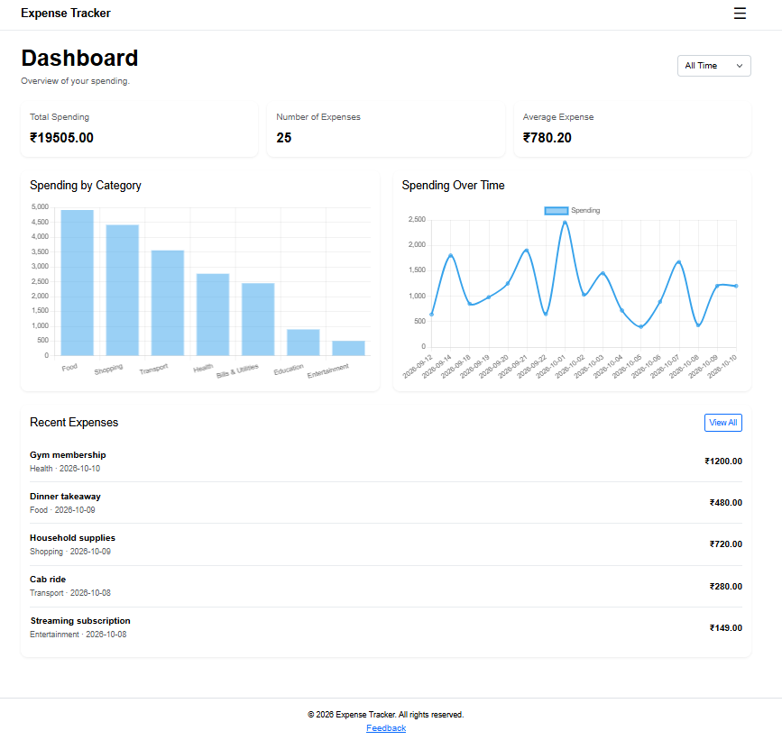
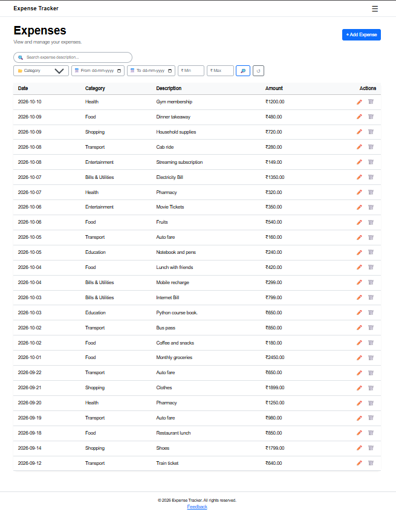
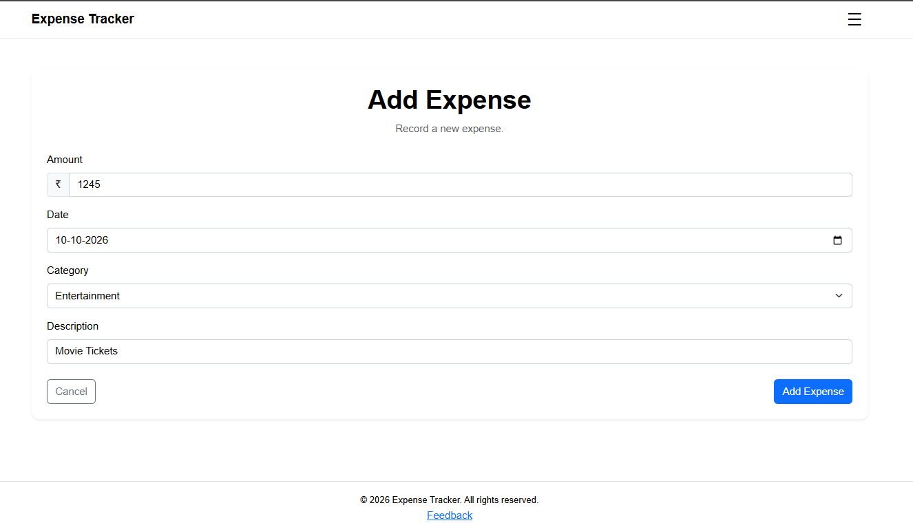
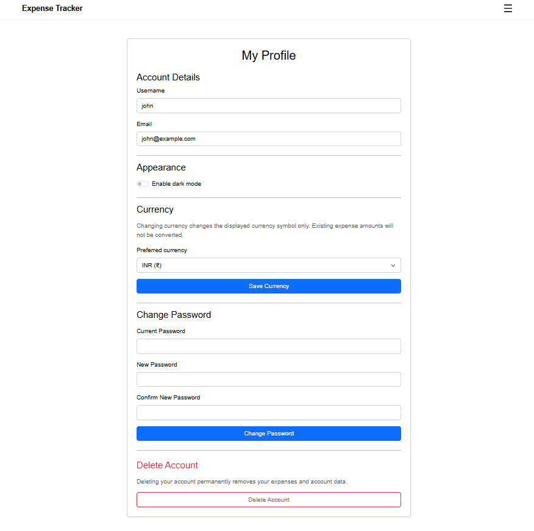

# Expense Tracker

A web application for recording, managing, searching, and analyzing personal expenses.


### Live Demo

Try the deployed application: [Expense Tracker](https://expense-tracker-dffqfghacma7cbce.centralindia-01.azurewebsites.net/)

### Video Demo: 

Take a look at the video demonstration: [Expense Tracker](https://youtu.be/f5AzChXBB10?si=gCumW3IeUaoBVVnc)

### Description:

Expense Tracker is a web application developed to help users manage and track their personal expenses.
It allows users to register, securely log in, record and manage
expenses, organize transactions by category, search and filter
expenses, and view spending summaries through a dashboard.

The application is built using Python, Flask, SQLite, SQL, HTML,
CSS, JavaScript, Bootstrap, and Jinja.


## Features

- User registration, login, and logout
- Case-sensitive usernames using letters, numbers, and underscores
- Live username and email availability checks
- Password show/hide controls
- Add, view, edit, and delete expenses
- Predefined expense categories
- Search and filter expenses by description, category, date range, and amount
- Dashboard with spending totals, expense count, average spending, category chart, and spending-over-time chart
- Password reset using email OTP verification
- Account management, including password change and currency selection
- Account deletion with email OTP verification and final confirmation
- Deleted-account history preserving the username, email, and deletion timestamp
- Responsive interface built with Bootstrap
- Reusable site footer across pages

## Technologies Used

- **Backend:** Python, Flask
- **Database:** SQLite, SQL
- **Frontend:** HTML, CSS, JavaScript, Bootstrap
- **Templating:** Jinja
- **Charts:** Chart.js
- **Security:** Werkzeug password hashing utilities

## Screenshots

### Dashboard


### Expenses


### Add Expense


### User Profile



## Setup and Installation

### Prerequisites

- Python
- Git (if cloning the repository)

### 1. Clone the repository

```bash
git clone https://github.com/ManasaProdduturi/expense-tracker
cd expense-tracker
```

Alternatively, download the repository files.

### 2. Create a virtual environment

```bash
python -m venv .venv
```

Activate it on Windows:

```bash
.venv\Scripts\activate
```

### 3. Install dependencies

```bash
pip install -r requirements.txt
```

### 4. Configure environment variables

Copy `.env.example` to `.env` and configure the required environment variables, including your Flask secret key and email/SMTP settings.

Use your own credentials. Never commit your `.env` file or expose private credentials.

### 5. Initialize the database

```bash
python database.py
```

### 6. Run the application

```bash
python app.py
```

Open the local Flask address displayed in your terminal in your browser.

## Project Structure

The main project files and directories include:

- `app.py` — Flask application and routes
- `database.py` — database connection and initialization logic
- `schema.sql` — database schema
- `templates/` — HTML templates rendered using Jinja
- `static/css/` — CSS stylesheets
- `static/js/` — JavaScript files
- `requirements.txt` — Python dependencies
- `.env.example` — example environment configuration

## Security Notes

- Environment variables are used for sensitive configuration.
- `.env` is excluded from the repository.
- `database.db` is excluded to avoid publishing local database contents.
- Passwords and verification codes are hashed before being stored.
- Database queries use parameterized SQL statements for user-provided values.

## Acknowledgements and References

- [Python Documentation](https://docs.python.org/3/)
- [Flask Documentation](https://flask.palletsprojects.com/)
- [SQLite Documentation](https://www.sqlite.org/docs.html)
- [Werkzeug Documentation](https://werkzeug.palletsprojects.com/)
- [Bootstrap Documentation](https://getbootstrap.com/docs/)
- [Jinja Documentation](https://jinja.palletsprojects.com/)
- [Chart.js Documentation](https://www.chartjs.org/docs/latest/)
- [ChatGPT](chatgpt.com) — used for development guidance, troubleshooting, and understanding implementation concepts.

## Project Background

I built Expense Tracker as my final project for Harvard University's CS50x course to apply the programming concepts and skills I learned throughout the course. I wanted to create a practical application that solves a real-world problem while challenging myself to work with Python, Flask, SQL, and web development. This project gave me an opportunity to bring together what I learned and gain hands-on experience building a complete application.

### Feel free to leave the feedback!
